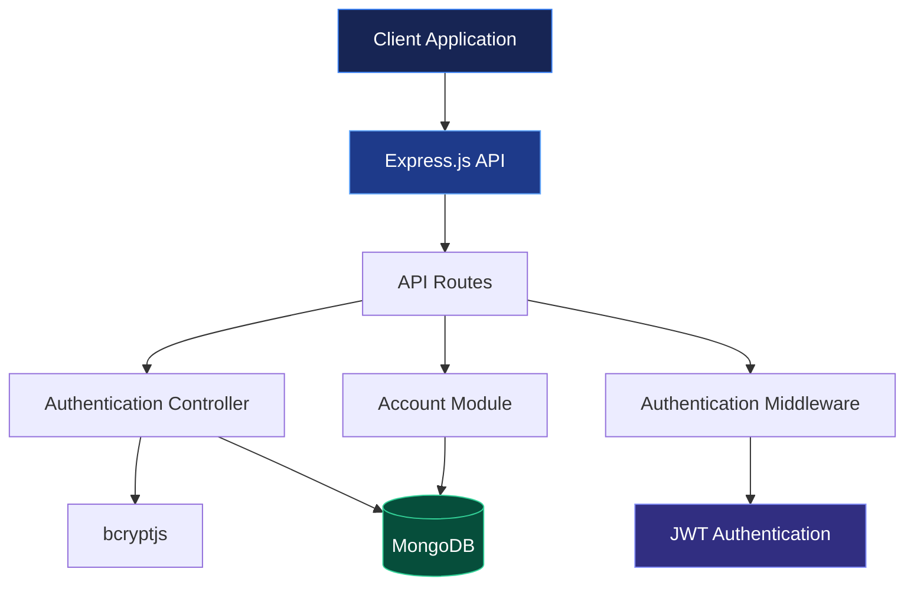
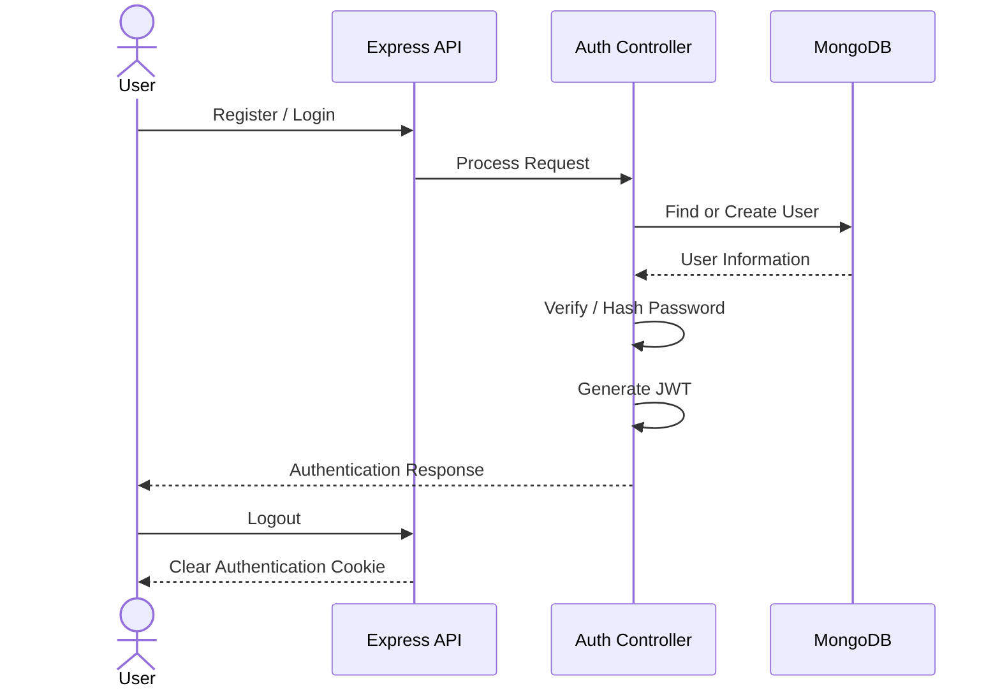

 <div align="center">

# 🏦 Banking Backend

### Secure Banking REST API

Building a scalable and secure backend for modern banking applications.

<br/>


<br/>

[Overview](#-overview) · [Features](#-features) · [Architecture](#-architecture) · [API](#-api-endpoints) · [Setup](#-getting-started)

</div>

---

## 📌 Overview

Banking Backend is a REST API project built using **Node.js, Express.js, TypeScript, and MongoDB**.

The project focuses on building backend infrastructure for banking applications, including user authentication, account-related functionality, and database management.

It uses JWT authentication, password hashing, and Docker-based local infrastructure.

## ✨ Features

### 🔐 Authentication

- User registration.
- User login.
- JWT-based authentication.
- Password hashing with bcryptjs.
- Cookie-based token management.
- User logout.

### 🏦 Account Module

- Account module development.
- Banking account functionality.

### ⚙️ Backend Infrastructure

- TypeScript-based development.
- Express.js REST API.
- MongoDB database integration.
- Mongoose ODM.
- Docker Compose configuration.
- Environment-based configuration.

## 🏗️ Architecture



## 🔄 Authentication Flow



## 🛠️ Tech Stack

| Technology | Purpose |
|---|---|
| TypeScript | Type-safe development |
| Node.js | Runtime environment |
| Express.js 5 | Backend framework |
| MongoDB | NoSQL database |
| Mongoose | Database modeling |
| JWT | Authentication |
| bcryptjs | Password hashing |
| Cookie Parser | Cookie management |
| Nodemailer | Email functionality |
| Docker Compose | Container infrastructure |

## 📡 API Endpoints

Base URL:

```text
/api/v1
```

### Authentication

| Method | Endpoint | Description |
|---|---|---|
| POST | `/auth/register` | Register a new user |
| POST | `/auth/login` | Login existing user |
| POST | `/auth/logout` | Logout user |

### Register

**Request:**

```json
{
  "name": "John Doe",
  "email": "john@example.com",
  "password": "your_password"
}
```

### Login

**Request:**

```json
{
  "email": "john@example.com",
  "password": "your_password"
}
```

**Response fields:**

```json
{
  "userId": "USER_ID",
  "name": "John Doe",
  "email": "john@example.com",
  "token": "JWT_TOKEN"
}
```

*Example response fields; actual response may differ.*

## 🚀 Getting Started

### Prerequisites

- Node.js
- npm
- Docker
- Docker Compose
- Git

### 1. Clone Repository

```bash
git clone https://github.com/Maniraj-CS/banking-backend.git

cd banking-backend
```

### 2. Install Dependencies

```bash
npm install
```

### 3. Configure Environment

Create a `.env` file in the root directory.

```env
PORT=5000
MONGODB_URI=mongodb://localhost:27017/banking
JWT_SECRET=your_secret_key
```

Use the exact variable names required by your application configuration.

### 4. Run Development Server

```bash
npm run dev
```

### 5. Production Build

```bash
npm run build
npm start
```

## 📂 Project Structure

```text
banking-backend/
│
├── src/
│   └── Application source code
│
├── dist/
│   └── Compiled JavaScript
│
├── docker-compose.yml
├── mongoose.txt
├── package.json
├── package-lock.json
├── tsconfig.json
├── .gitignore
└── README.md
```

## 🔒 Security

- Password hashing with bcryptjs.
- JWT-based authentication.
- Cookie-based token management.
- Environment-based secret configuration.
- Protected API routes.

## 🗺️ Future Improvements

- [ ] Complete account management.
- [ ] Deposit and withdrawal operations.
- [ ] Fund transfers.
- [ ] Transaction history.
- [ ] Transaction validation.
- [ ] Automated testing.
- [ ] API documentation.
- [ ] Production deployment.

## 👨‍💻 Author

**Maniraj Pandit**

[GitHub](https://github.com/Maniraj-CS)

[Repository](https://github.com/Maniraj-CS/banking-backend)

---

<div align="center">

### Building reliable backend infrastructure.

⭐ If you find this project interesting, consider giving it a star!

</div>